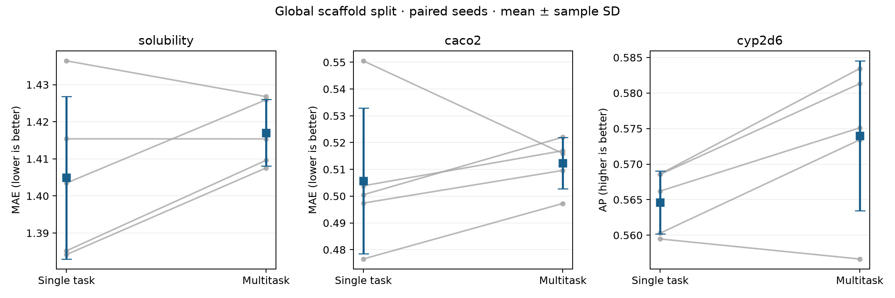

# Multi-endpoint ADMET — does multitask learning help?

## Question

Does a shared molecular representation improve aqueous solubility, Caco-2
permeability and CYP2D6 inhibition predictions compared with independent
single-task models?

**Result: this experiment does not establish a multitask benefit.** None of
the three paired, multiplicity-adjusted improvement intervals excludes zero.
The CYP2D6 point estimate improves, while both regression point estimates worsen.

**Robustness follow-up (2026-10-24): still no multitask benefit.** Over five
scaffold-split seeds × five model seeds, with an equal-budget validation-only
search, multitask learning is 0/3 supported and solubility is *worse* (interval
entirely below zero); the earlier CYP2D6 point gain reverses sign. Details
[below](#robustness-follow-up).

## Approach

Use public [Therapeutics Data Commons ADME datasets](https://tdcommons.ai/single_pred_tasks/adme/)
from [Harvard Dataverse](https://doi.org/10.7910/DVN/21LKWG).
Standardize parent molecules, merge duplicates, mask unmeasured endpoints, and
split the union of molecules by Bemis–Murcko scaffold before any training.
The global split targets 70/15/15; both approaches use exactly the same split.

| Endpoint | Raw rows | Curated labels | Train | Validation | Test |
|---|---:|---:|---:|---:|---:|
| solubility | 9982 | 9140 | 8075 | 544 | 521 |
| caco2 | 910 | 821 | 594 | 102 | 125 |
| cyp2d6 | 13130 | 12824 | 7354 | 2733 | 2737 |


The union contains 22,248 molecules, of which 474
have more than one label. Actual train/validation/test molecule counts are
15,574/3,337/3,337.
The downloaded Caco-2 file contains 910 rows; source metadata
counts are not substituted for the actual file count.

A radius-2, 1024-bit Morgan fingerprint feeds a 128 → 64 ReLU MLP. Independent
networks and the shared-trunk model have identical per-task architecture,
initialization seeds, per-epoch label exposure and optimizer settings. The
independent approach uses 418,563 active parameters in total;
the multitask approach uses 139,651. This matches architecture per task,
not total parameter count. Training-only target scaling, task-balanced losses,
and validation-only early stopping are used. Test data are evaluated after
model selection. See [scope](docs/SCOPE.md), [methods](docs/METHODS.md) and
[data provenance](docs/DATA.md).

## Results

Five paired training seeds on one fixed scaffold split; values are
mean ± sample standard deviation. MAE is lower-is-better; average precision
(AP) is higher-is-better. Positive paired gains favor multitask learning.

| Endpoint | Metric | Test labels | Single task | Multitask | Paired gain [simultaneous CI] | Help supported? |
|---|---|---:|---:|---:|---:|---|
| solubility | MAE | 521 | 1.4049 ± 0.0219 | 1.4170 ± 0.0090 | -0.0121 [-0.0402, 0.0160] | No |
| caco2 | MAE | 125 | 0.5058 ± 0.0272 | 0.5124 ± 0.0095 | -0.0066 [-0.0481, 0.0349] | No |
| cyp2d6 | AP | 2737 | 0.5646 ± 0.0044 | 0.5740 ± 0.0106 | 0.0094 [-0.0033, 0.0220] | No |


Intervals are two-sided paired t intervals with Bonferroni correction across
three endpoints (per-interval confidence 98.3333%, family alpha 0.05).
The predeclared practical threshold is 5% relative MAE reduction or 0.02 absolute
AP increase, alongside an interval strictly above zero. The evidence supports
0/3 endpoint-level improvement claims. This is insufficient
evidence of benefit, rather than proof that the approaches are equivalent.



The full experiment took 65.87 seconds on CPU with
2 PyTorch threads in the recorded environment.

### Verification and evidence

- Datasets: 3/3, each with source URL, byte count and SHA-256.
- Test metric records: 30/30; saved predictions: 33,830/33,830.
- Leakage checks: 6/6; total molecule/scaffold overlaps: 0.
- Smallest observed task/partition: 102 labels, exceeding the declared minimum of 30; both CYP classes occur in each partition.
- AqSolDB invalid/nonfinite rows removed: 4; conflicting CYP2D6 molecule labels removed: 34.
- Automated tests exercise standardization, missing-label gradients, label-blind splitting, leakage rejection, test-label isolation during live training, download integrity and recomputation of every committed metric.

Machine-readable evidence: [comparison](results/comparison.csv),
[per-seed metrics](results/metrics.csv), [paired differences](results/paired_differences.csv),
[predictions](results/predictions.csv.gz), [molecules and split](results/molecules.csv.gz),
[audit](results/audit.json), [acceptance checks](results/acceptance.json),
[validation histories](results/training.json), [runtime and versions](results/run_metadata.json),
and [artifact hashes](results/artifact_manifest.json).
[CI](https://github.com/Akkaya-Furkan/admet-multitask/actions/workflows/ci.yml)
runs unit tests, live training smoke tests and committed-result checks without
requiring a network dataset download or repeating the full experiment.

## Robustness follow-up

Closes three earlier gaps: five scaffold splits (seeds 20261024–20261028) × five
paired model seeds (150 test metrics, 169,170 saved predictions); an equal-budget
search per split, per approach, over three complete (learning rate, weight decay)
bundles — (0.001, 0.0001), (0.0003, 0.0001), (0.001, 0.001) — selected on
validation loss only (test targets are masked for every fit); and a test→train
nearest-neighbor Tanimoto audit. Equal budget means equal candidate/task
exposure, not equal FLOPs or runtime. The 25 runs are overlapping holdouts, not
independent datasets: intervals are hierarchical percentile bootstrap (split
clusters, then seeds within split; 20,000 draws) and exploratory.

| Endpoint | Single task | Multitask | Paired gain [95% CI] | Bonferroni 98.33% CI | Help supported? |
|---|---:|---:|---:|---:|---|
| solubility (MAE) | 1.3835 | 1.4295 | -0.0460 [-0.0651, -0.0289] | [-0.0701, -0.0255] | No (multitask worse) |
| caco2 (MAE) | 0.4876 | 0.4946 | -0.0070 [-0.0194, 0.0081] | [-0.0215, 0.0115] | No |
| cyp2d6 (AP) | 0.5549 | 0.5332 | -0.0217 [-0.0617, 0.0040] | [-0.0719, 0.0063] | No |

Selected bundles over 5 splits: single task candidate 0 ×2 / candidate 2 ×3;
multitask candidate 0 ×3 / candidate 2 ×2 (candidate 1 never). **Conclusion:** no
multitask benefit is detected with this fingerprint MLP and search; for solubility
the data indicate a harm (-3.3% relative MAE). Caco-2 and CYP2D6 are inconclusive
(intervals include zero); the CYP2D6 sign differs from the single-split run, so
that earlier point gain should not be read as signal.

**Nearest-neighbor audit** (radius-2, 1024-bit Morgan, test molecule vs. all
training molecules, 16,685 test molecule-split pairs over 5 splits): median
Tanimoto 0.44 per split (0.439–0.443); 441 pairs ≥ 0.8, 90 ≥ 0.9, 36 equal to 1.0
(1.0 can be a fingerprint collision). Per endpoint ≥ 0.8: solubility 133/2710,
caco2 33/574, cyp2d6 279/13633. No similarity-based exclusion was applied
(descriptive only). Canonical-tautomer identities still cross partitions
(5–11 shared per partition pair per split) and RDKit enumeration did not
complete for 181 molecules; tautomer-grouped retraining is not done.

Run `make robustness` (about 425 s on CPU with 2 threads on the recorded
desktop). Evidence is in `results/robustness/` (metrics, predictions, splits,
search scores, training histories, neighbors, similarity summary, hashes).

## Reproduce

```bash
~/miniconda3/bin/conda env create -f environment.yml
conda activate p24-admet
python scripts/download_data.py
python scripts/run_experiment.py
python scripts/summarize.py
python -m pytest -q
```

Run commands from the repository root. `requirements.txt` pins the observed
Python dependencies, including CPU PyTorch; `environment.yml` uses Python 3.11.
`make experiment` runs download, training and reporting. Raw files are cached
under `data/raw/` and excluded from Git. Downloaded or cached files that differ
from the recorded hashes are rejected. Re-running training overwrites results;
run summarization afterwards to refresh reports and integrity hashes.

## Limitations

- Repeated scaffold splits / split-level uncertainty: **done** (5 splits × 5
  seeds, see robustness follow-up). The splits overlap and share one split
  algorithm, so intervals remain exploratory.
- Hyperparameter search: **done, small** (3 bundles, one shared setting across
  tasks, validation only). Broad search and graph neural network baselines:
  **not done**. Conclusions apply to this fingerprint MLP.
- Prospective validation, external cohorts and assay harmonization: **not done**.
  The labels come from heterogeneous assays and mostly different molecules.
- Nearest-neighbor similarity audit and tautomer-overlap count: **done**
  (descriptive). Similarity-based exclusion and tautomer-grouped retraining:
  **not done**. Salt/stereoisomer identity and Murcko-scaffold checks do not eliminate every
  form of chemical similarity or source-level overlap.
- Matched total parameter budgets and matched compute: **not done**. Shared
  and independent models also use different validation aggregation for stopping.
- Model checkpoint export and deployment: **not done**. Predictions, configuration
  and validation histories are retained; this is a reproducible comparison,
  not a clinical or production predictor.
- The 2,703 acyclic molecules share one empty scaffold
  and stay together; label ratios per task differ from global molecule ratios.
  Largest-first allocation places frequent scaffolds in training and singleton
  scaffolds in held-out partitions; this is one specific generalization test.
